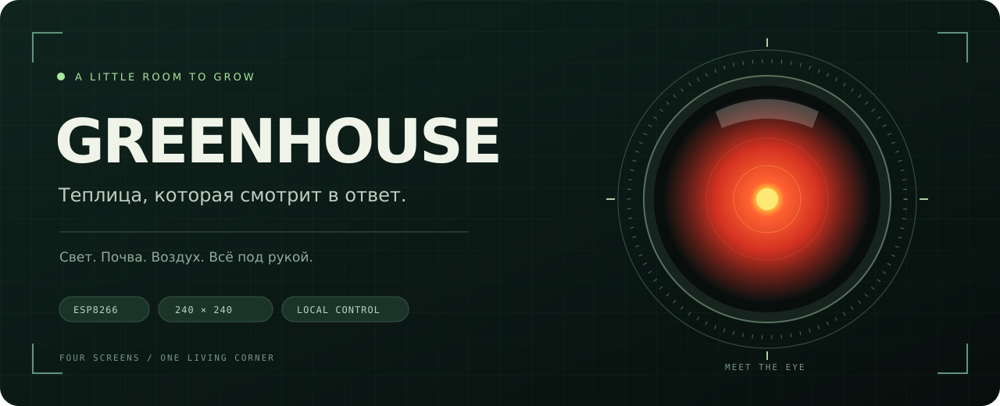
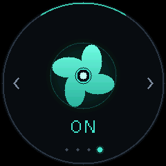

# Greenhouse

**A greenhouse that looks back.** An ESP8266 mini-greenhouse controller with two lighting modes, soil moisture and air temperature on a single round display.



<p align="center">
  
  
  
  
</p>

<p align="center">
  <a href="#interface">Interface</a> ·
  <a href="#hardware">Hardware</a> ·
  <a href="#getting-started">Getting started</a> ·
  <a href="#checks">Checks</a> ·
  <a href="docs/hardware-status.md">Hardware status</a>
</p>

Built for a small living corner: turn on warm light, switch to UV, or check the sensors. Four touch buttons provide local control, with a dedicated screen for each function.

**Start with [GreenhouseSimple](GreenhouseSimple/README.md)**, the current firmware with the round interface. It runs locally, without Wi-Fi or a cloud service. An earlier automation prototype is also preserved in this repository; the differences are explained [below](#two-firmware-versions).

## Interface

### 00 / First, a glance

At startup, a red eye smoothly looks around before the warm-light page appears. All load commands start OFF.

<p align="center">
  
</p>

A familiar lens silhouette, a touch of science fiction, and a quiet interface after the opening animation.

### 01-04 / One circle, four screens

<table>
  <tr>
    <th>01 · Warm light</th>
    <th>02 · Ultraviolet</th>
    <th>03 · Soil and air</th>
    <th>04 · Fans</th>
  </tr>
  <tr>
    <td align="center"></td>
    <td align="center"></td>
    <td align="center"></td>
    <td align="center"></td>
  </tr>
</table>

*These previews are generated from the firmware renderer. Sensor values are illustrative; ON represents the controller command, not confirmation that a load is physically running.*

| Screen | Select button action | Display |
|---|---|---|
| Warm light | Toggle K2 | Yellow bulb, `ON` / `OFF` |
| Ultraviolet | Toggle K1 | Violet bulb, `ON` / `OFF` |
| Soil and air | Request fresh measurements | Soil moisture in `%`, **air** temperature in `°C` |
| Fans | Toggle the P15 relay command | Turquoise fan, `ON` / `OFF` |

Warm light and UV are mutually exclusive. Switching between them includes an 80 ms interval with both relays OFF. The current firmware has no lighting schedule or automatic shutoff timer; losing communication with the expander clears load commands.

### Simple controls

| Button | Action |
|---|---|
| **1 · ←** | Previous screen |
| **2 · →** | Next screen, wrapping around |
| **3 · Select** | Perform the current screen's action |
| **4 · Stop** | Turn all load commands OFF |

Holding a button does not repeat its action. A button held during startup must be released before it can trigger an action.

## Hardware

| Component | Role | Connection |
|---|---|---|
| **NodeMCU ESP8266** | Controller | NodeMCU 1.0, ESP-12E |
| **GC9A01A** | Round 240 × 240 TFT | SPI, rotation `3` |
| **PCF8575** | Touch buttons and relays | I²C `0x20` |
| **ADS1115** | Soil sensor acquisition | I²C `0x48`, input A0 |
| **HTU21** | Air temperature | I²C `0x40` |
| **K1 / K2** | UV / warm light | PCF P0 / P1, active LOW |
| **Fan relay** | Ventilation command | PCF P15, active HIGH |

**I²C:** SDA → D2, SCL → D1. **Display:** SCK → D5, MOSI → D7, CS → D8, DC → D3, RST → D4.

> PCF8575 P15 is **bit 13**, mask `0x2000`. It is not ESP8266 GPIO15. Physical operation of the new fan relay has not yet been confirmed.

See the full [pinout](GreenhouseSimple/PINOUT.md) and [known hardware limitations](docs/hardware-status.md).

## How it works

- **Nonblocking measurements.** ADS1115 and HTU21 conversions run between button handling and rendering. Temperature readings are CRC-checked.
- **Two-point calibration.** Dry and wet soil define a relative 0-100% scale, not a laboratory measurement of volumetric water content. A different sensor or soil needs its own reference points.
- **Freshness checks.** Soil readings older than 2 seconds and temperature readings older than 5 seconds are replaced with `--`.
- **Persistent settings.** Calibration is stored in EEPROM with a version and CRC32. Saved values take priority over the defaults in the source code.
- **Strip rendering.** A 3,840-byte buffer replaces a full framebuffer. Readings update within a 240 × 80 region without an intermediate black frame.

## Getting started

### Arduino IDE

1. Clone the repository:

   ```bash
   git clone https://github.com/TeemFlash/Greenhouse.git
   cd Greenhouse
   ```

2. Add this URL under Additional Boards Manager URLs:

   ```text
   https://arduino.esp8266.com/stable/package_esp8266com_index.json
   ```

3. Install **esp8266 by ESP8266 Community 3.1.2** and select **NodeMCU 1.0 (ESP-12E Module)**. Set CPU to 80 MHz and flash to 4 MB.
4. Install **Adafruit GC9A01A**, **Adafruit GFX Library**, and **Adafruit BusIO**.
5. Open [`GreenhouseSimple.ino`](GreenhouseSimple/GreenhouseSimple/GreenhouseSimple.ino), keeping its neighboring `.h` files in the same folder. Run Verify, then select your board's port to upload. Set Serial Monitor to **115200 baud**.

Before uploading, review the [wiring and limitations](docs/hardware-status.md). Wire, SPI and EEPROM are included in the ESP8266 package.

### Arduino CLI

After installing the same board package and libraries, run from the repository root:

```bash
arduino-cli compile --warnings all --fqbn esp8266:esp8266:nodemcuv2 GreenhouseSimple/GreenhouseSimple
```

### Calibration and diagnostics

On the sensor page, turn all load commands OFF with button 4. Place the sensing section in dry soil, wait for a stable reading, and send `d` through Serial Monitor. Repeat in wet soil with `w`. Points that are too close are rejected; an error preserves the previous settings.

Send `?` for status, raw readings, calibration and I²C addresses. Send `e` to replay the eye animation. See the [firmware guide](GreenhouseSimple/README.md) for details.

## Two firmware versions

| | **GreenhouseSimple** · current | **GreenhouseController** · early prototype |
|---|---|---|
| Interface | Eye and four round screens | Six pages and a web panel |
| Control | Manual, local | Manual and automatic |
| Sensors | Soil moisture, air temperature | Soil, water level, air temperature and humidity |
| Extras | EEPROM calibration | Irrigation, schedules, SD logging, Wi-Fi, SNTP |
| Fan wiring | New P15 relay | Previous driver circuit |

**Use GreenhouseSimple for the device shown here.** The early prototype has not been adapted to the new P15 relay and is not a verified replacement for the current firmware. Its [original Russian guide](GreenhouseController/README_RU.txt) remains alongside the source.

## Project layout

```text
Greenhouse/
├── README.md
├── docs/                       Cover artwork and hardware status
├── GreenhouseSimple/
│   ├── GreenhouseSimple/       Current Arduino sketch and modules
│   ├── preview/                Screens and animation from the firmware renderer
│   ├── tests/                  Controls, buttons, sensors and calibration
│   ├── tools/                  Preview and USB diagnostics
│   ├── PINOUT.md               Current assembly pinout
│   └── README.md               Detailed firmware guide
└── GreenhouseController/       Earlier automation prototype
```

Original Russian wiring notes, development plans and test logs are preserved as project history. The English guides describe the current firmware and its limitations.

## Checks

Logic tests run on a computer without a board. With GCC or Clang, run from the repository root:

```bash
for name in control menu calibration; do
  c++ -std=c++11 -Wall -Wextra -Werror "GreenhouseSimple/tests/${name}_tests.cpp" -o "/tmp/greenhouse-${name}"
  "/tmp/greenhouse-${name}"
done

c++ -std=c++11 -Wall -Wextra -Werror -IGreenhouseSimple/tests/stubs GreenhouseSimple/tests/soil_tests.cpp -o /tmp/greenhouse-soil
/tmp/greenhouse-soil

c++ -std=c++11 -Wall -Wextra -Werror -IGreenhouseSimple/tests/temperature_stubs GreenhouseSimple/tests/temperature_tests.cpp -o /tmp/greenhouse-temperature
/tmp/greenhouse-temperature
```

These tests cover lighting exclusivity, relay commands, button handling, sensor errors and calibration. The [test history (Russian)](GreenhouseSimple/VALIDATION.txt) distinguishes software checks from results on the board. USB scripts in `tools/` interact with the real device and are not part of the ordinary tests above.

**This project remains a hardware prototype.** Unexpected light shutoff is still unresolved; boot and I²C issues have also been observed. Confirmed results and open issues are collected in the [hardware status](docs/hardware-status.md).

---

The visual flow of this README is inspired by [ByeQaryz](https://github.com/Garryflop/byeqaryz): from the first screen to the project's inner workings. The cover was made for Greenhouse, and the screen previews come from its own renderer. Font terms are in [FONT_LICENSE.txt](GreenhouseSimple/FONT_LICENSE.txt).

<p align="center"><sub>Four screens. One living corner.</sub></p>
