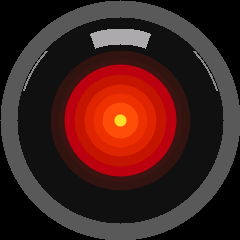
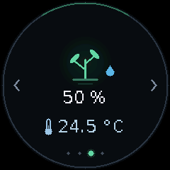

# Greenhouse

**Теплица, которая смотрит в ответ.** Контроллер мини-теплицы на ESP8266: два вида света, влажность почвы и температура воздуха — на одном круглом дисплее.


<p align="center">
  
  
  
  
</p>

<p align="center">
  <a href="#интерфейс">Интерфейс</a> ·
  <a href="#железо">Железо</a> ·
  <a href="#запуск">Запуск</a> ·
  <a href="#проверки">Проверки</a> ·
  <a href="docs/hardware-status.md">Статус устройства</a>
</p>

Проект для небольшого живого уголка: включить тёплый свет, переключиться на УФ, посмотреть показания датчиков. Четыре сенсорные кнопки заменяют меню на телефоне, а каждому действию соответствует отдельный экран.

**Начать с [GreenhouseSimple](GreenhouseSimple/README_RU.txt)** — это текущая прошивка с круглым интерфейсом. Она работает локально, без Wi-Fi и облака. В репозитории также сохранён ранний вариант с автоматикой; различия описаны [ниже](#две-версии-прошивки).

## Интерфейс

### 00 / Сначала — взгляд

При включении появляется красный глаз: он плавно переводит взгляд в разные стороны. Затем открывается страница тёплого света. Команды всем нагрузкам при старте выключены.

<p align="center">
  
</p>

Это характер устройства: знакомый силуэт объектива, немного научной фантастики и спокойный интерфейс после заставки.

### 01—04 / Один круг, четыре экрана

<table>
  <tr>
    <th>01 · Тёплый свет</th>
    <th>02 · Ультрафиолет</th>
    <th>03 · Почва и воздух</th>
    <th>04 · Кулеры</th>
  </tr>
  <tr>
    <td align="center"></td>
    <td align="center"></td>
    <td align="center"></td>
    <td align="center"></td>
  </tr>
</table>

*Изображения получены из кода отрисовки прошивки. Значения датчиков — демонстрационные; ON показывает команду контроллера, а не подтверждение работы нагрузки.*

| Экран | Действие кнопки «выбрать» | Что видно |
|---|---|---|
| Тёплый свет | Включить или выключить K2 | Жёлтая лампочка, `ON` / `OFF` |
| Ультрафиолет | Включить или выключить K1 | Фиолетовая лампочка, `ON` / `OFF` |
| Почва и воздух | Запросить свежие измерения | Влажность почвы в `%`, температура **воздуха** в `°C` |
| Кулеры | Переключить команду реле P15 | Бирюзовый вентилятор, `ON` / `OFF` |

Тёплый свет и УФ включаются по одному. Между ними выдерживается пауза 80 мс с обоими реле OFF. В текущей прошивке нет расписания или таймера выключения света; потеря связи с расширителем сбрасывает команды нагрузкам.

### Управление без лишних надписей

| Кнопка | Действие |
|---|---|
| **1 · ←** | Предыдущий экран |
| **2 · →** | Следующий экран; переход по кругу |
| **3 · Выбрать** | Действие текущего экрана |
| **4 · Стоп** | Выключить все нагрузки |

Удержание не повторяет действие. Кнопка, зажатая при запуске, должна быть отпущена перед первым срабатыванием.

## Железо

| Компонент | Роль | Подключение |
|---|---|---|
| **NodeMCU ESP8266** | Контроллер | NodeMCU 1.0, ESP-12E |
| **GC9A01A** | Круглый TFT 240 × 240 | SPI, поворот `3` |
| **PCF8575** | Сенсорные кнопки и реле | I²C `0x20` |
| **ADS1115** | Чтение датчика почвы | I²C `0x48`, вход A0 |
| **HTU21** | Температура воздуха | I²C `0x40` |
| **K1 / K2** | УФ / тёплый свет | PCF P0 / P1, активный LOW |
| **Реле кулеров** | Команда вентиляции | PCF P15, активный HIGH |

**I²C:** SDA → D2, SCL → D1. **Дисплей:** SCK → D5, MOSI → D7, CS → D8, DC → D3, RST → D4.

> P15 на PCF8575 — **бит 13**, маска `0x2000`. Это не GPIO15 ESP8266. Физическое срабатывание нового реле кулеров пока не подтверждено.

Полная [распиновка](GreenhouseSimple/PINOUT_RU.txt) и [известные особенности сборки](docs/hardware-status.md).

## Как это работает

- **Измерения без ожидания в цикле.** ADS1115 и HTU21 выполняют преобразования между обработкой кнопок и отрисовкой. Для температуры проверяется CRC.
- **Калибровка по двум точкам.** Сухой и влажный грунт задают относительную шкалу 0–100%. Это не лабораторное измерение объёмной доли воды. Для другого датчика или грунта нужны свои точки.
- **Свежесть данных.** Почва старше 2 секунд и температура старше 5 секунд не выдаются за актуальные: экран показывает `--`.
- **Сохранение настроек.** Калибровка хранится в EEPROM с версией и CRC32. Сохранённые значения имеют приоритет над исходными точками в коде.
- **Отрисовка полосами.** Буфер 3840 байт вместо полного кадра. Показания обновляются в области 240 × 80 без промежуточного чёрного экрана.

## Запуск

### Arduino IDE

1. Клонировать репозиторий:

   ```bash
   git clone https://github.com/TeemFlash/Greenhouse.git
   cd Greenhouse
   ```

2. В дополнительных URL менеджера плат добавить:

   ```text
   https://arduino.esp8266.com/stable/package_esp8266com_index.json
   ```

3. Установить **esp8266 by ESP8266 Community 3.1.2** и выбрать **NodeMCU 1.0 (ESP-12E Module)**. CPU — 80 MHz, Flash — 4 MB.
4. Установить библиотеки **Adafruit GC9A01A**, **Adafruit GFX Library**, **Adafruit BusIO**.
5. Открыть [`GreenhouseSimple.ino`](GreenhouseSimple/GreenhouseSimple/GreenhouseSimple.ino), сохранив соседние `.h` в той же папке. Выполнить «Проверить» и выбрать порт своей платы для загрузки. Serial Monitor — **115200 бод**.

Перед загрузкой сверить [распиновку и ограничения](docs/hardware-status.md). Wire, SPI и EEPROM входят в пакет ESP8266.

### Arduino CLI

После установки того же пакета платы и библиотек, из корня репозитория:

```bash
arduino-cli compile --warnings all   --fqbn esp8266:esp8266:nodemcuv2   GreenhouseSimple/GreenhouseSimple
```

### Калибровка и диагностика

На странице датчиков выключить нагрузки кнопкой 4. Поместить чувствительную часть датчика в сухой грунт, дождаться стабильного показания и отправить `d` через Serial Monitor. Повторить во влажном грунте командой `w`. Слишком близкие точки отклоняются; старые настройки сохраняются при ошибке.

Команда `?` выводит состояние, реальные отсчёты, калибровку и адреса I²C. `e` повторяет заставку. Подробности — в [инструкции](GreenhouseSimple/README_RU.txt).

## Две версии прошивки

| | **GreenhouseSimple** · текущая | **GreenhouseController** · ранний прототип |
|---|---|---|
| Интерфейс | Глаз и четыре круглых экрана | Шесть страниц и веб-панель |
| Управление | Ручное, локальное | Ручное и автоматическое |
| Датчики | Почва, температура воздуха | Почва, вода, температура и влажность воздуха |
| Дополнительно | Калибровка EEPROM | Полив, расписания, SD-журнал, Wi-Fi, SNTP |
| Схема кулеров | Новое реле P15 | Предыдущая схема драйвера |

**Для показанного здесь устройства использовать GreenhouseSimple.** Ранний прототип не перенесён на новое реле P15 и не заявлен как проверенная замена текущей прошивке. Его [инструкция](GreenhouseController/README_RU.txt) сохранена рядом с исходниками.

## Структура проекта

```text
Greenhouse/
├── README.md
├── docs/                       Обложка и статус устройства
├── GreenhouseSimple/
│   ├── GreenhouseSimple/       Текущий Arduino-скетч и модули
│   ├── preview/                Экраны и анимация из рендера прошивки
│   ├── tests/                  Управление, кнопки, датчики, калибровка
│   ├── tools/                  Предпросмотр и USB-диагностика
│   ├── PINOUT_RU.txt           Распиновка текущей сборки
│   └── README_RU.txt           Подробная инструкция
└── GreenhouseController/       Ранний вариант с автоматикой
```

## Проверки

Тесты логики запускаются на компьютере без платы. Для GCC/Clang из корня репозитория:

```bash
for name in control menu calibration; do
  c++ -std=c++11 -Wall -Wextra -Werror     "GreenhouseSimple/tests/${name}_tests.cpp" -o "/tmp/greenhouse-${name}"
  "/tmp/greenhouse-${name}"
done

c++ -std=c++11 -Wall -Wextra -Werror -IGreenhouseSimple/tests/stubs   GreenhouseSimple/tests/soil_tests.cpp -o /tmp/greenhouse-soil
/tmp/greenhouse-soil

c++ -std=c++11 -Wall -Wextra -Werror -IGreenhouseSimple/tests/temperature_stubs   GreenhouseSimple/tests/temperature_tests.cpp -o /tmp/greenhouse-temperature
/tmp/greenhouse-temperature
```

Проверяются взаимное исключение света, команды реле, обработка кнопок, ошибки датчиков и калибровка. [История испытаний](GreenhouseSimple/VALIDATION.txt) отдельно описывает проверки кода и результаты на плате. USB-скрипты в `tools/` взаимодействуют с настоящим устройством; в обычные тесты выше они не входят.

**Проект остаётся аппаратным прототипом.** Вопрос с самопроизвольным отключением света не закрыт; отмечены также особенности загрузки и I²C. Подтверждённые результаты и открытые проблемы собраны в [статусе устройства](docs/hardware-status.md).

---

Визуальная история README вдохновлена [ByeQaryz](https://github.com/Garryflop/byeqaryz): от первого экрана к устройству проекта. Обложка сделана для Greenhouse, экраны взяты из собственного кода отрисовки. Условия использования шрифта — в [FONT_LICENSE.txt](GreenhouseSimple/FONT_LICENSE.txt).

<p align="center"><sub>Четыре экрана. Один живой уголок.</sub></p>
